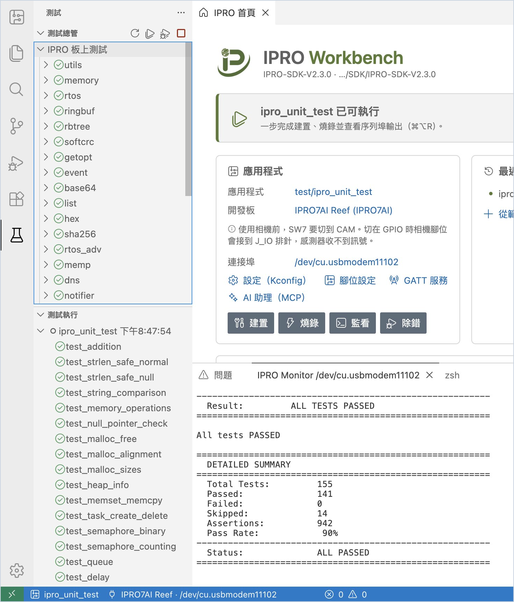
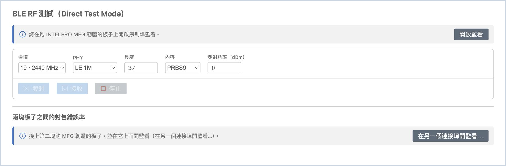
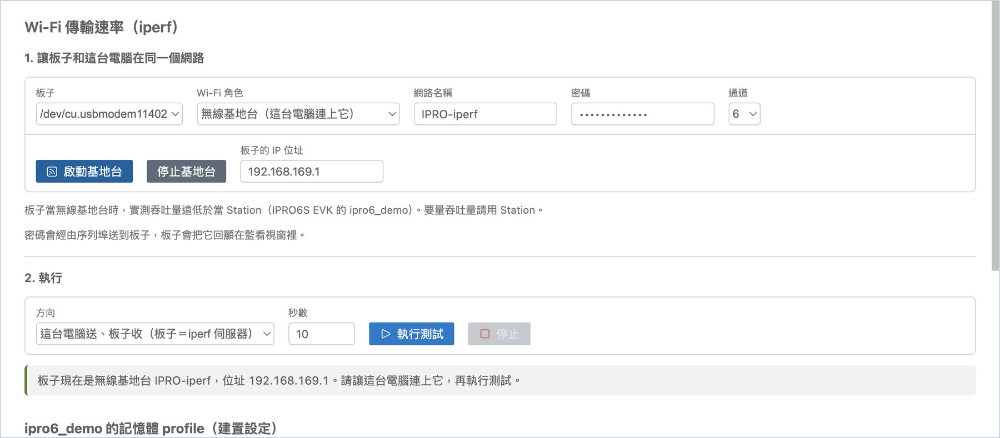
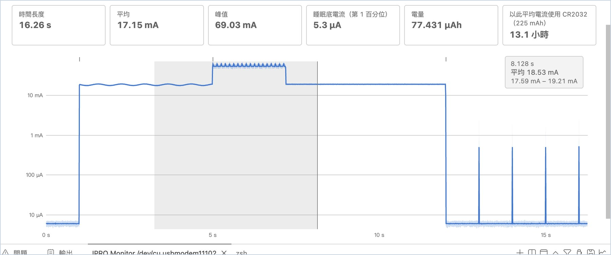

# 測試與量測

在板子上跑測試、量測 BLE 射頻、量測 Wi-Fi 傳輸速率，以及看功耗曲線。這幾個工具頁都可以從[首頁的「工具」卡片](index.md#home)或 IPRO 選單開啟。

## 板上測試 { #board-tests }

應用程式使用 SDK 的 Unity 測試框架時（例如 `ipro_unit_test`），板子印出的測試結果會整理進 IDE 的「測試」檢視。

<div class="ipro-steps" markdown>

1. **在板子上執行測試。** 選好應用程式並燒錄一次後，在側邊欄「開發板」上方按燒杯圖示（**在板子上執行測試**）。

    **應該看到**：通知「正在重置板子（序列埠監看開著）…」，板子經由探棒重新開機。左邊切到「測試」檢視：「測試執行」列出這一次的執行（例如「ipro_unit_test 下午2:10:16」），每個測試前面是通過、失敗或略過的符號；「測試總管」的「IPRO 板上測試」下列出每個測試組（utils、memory、rtos…）。

2. **看失敗的測試。** 失敗的測試點兩下，會打開測試的原始碼並跳到失敗的那一行。

3. **搭配建置、燒錄並監看。** 用 **建置、燒錄並監看** 執行時，結果也會自動進到「測試」檢視。

</div>



!!! note
    - 「測試」檢視讀的是板子開機後印出的測試行，所以監看要接在探棒的 UART（主控台）連接埠。開著監看的[篩選](monitor.md#filter)不影響結果。
    - 板子沒有重新開機時，IDE 會提示「板子沒有重新啟動。監看是否接在 IPRO Debug Probe 的主控台連接埠？」

## RF 測試（BLE DTM） { #rf-test }

「RF 測試」透過 INTELPRO 提供的 MFG 韌體，以 BLE Direct Test Mode 讓板子發射或接收，供頻譜分析儀、綜合測試儀量測，或兩塊板子之間量封包錯誤率（PER）。

<div class="ipro-steps" markdown>

1. **檢查韌體。** 板子燒入 MFG 韌體，開著序列埠監看。按首頁「工具」的 **RF 測試（DTM）**（或 IPRO 選單的 **RF 測試（DTM）…**），按 **檢查韌體**。MFG 韌體不包含在 IPRO SDK 中，請向 INTELPRO 業務窗口索取。

    **應該看到**：「MFG 韌體 1.01」。板子沒有回應時會顯示「板子沒有回應。它跑的是 MFG 韌體嗎？」

2. **發射或接收。** 選通道、PHY、長度、內容與發射功率，按 **發射** 或 **接收**，結束時按 **停止**。

    **應該看到**：發射時顯示「正在 2402 MHz 發射（1M，37 位元組，每 625 µs 一包）」這類訊息；接收停止後顯示「N 秒內收到 M 包；以標準速率的 DTM 發射端計算，PER 為 X%」。

    只按接收時，PER 是從板子回報開始接收起算，以 DTM 標準速率估算應收到的包數；發射端要在整段接收期間持續發射，估算才準。要讓 IDE 同時控制兩端，請用下一步的兩塊板子量測。

3. **兩塊板子量 PER。** 兩塊板子接在同一台電腦上，第二塊也燒入 MFG 韌體，按 **在另一個連接埠開監看…** 開它的監看（見[同時監看另一個連接埠](monitor.md#second-port)）；在「兩塊板子之間的封包錯誤率」選接收端與秒數，按 **測量 PER**。

    **應該看到**：結果表格多一列：時間、通道、PHY、發出（預期）、收到與 PER。

    兩塊板子接在不同電腦上時，在兩台電腦各開 IPRO Workbench：先在一台選好通道按 **發射**，再在另一台選同一個通道按 **接收**，幾秒後按 **停止**，接收端顯示收到的包數與估算的 PER。

</div>



!!! tip
    附近有 Wi-Fi 時，和 Wi-Fi 頻道重疊的 BLE 通道會大量掉包（例如 2440 MHz 一帶）。量 PER 時請選和附近 Wi-Fi 錯開的通道，例如 2478 MHz。

!!! note
    每次開始測試時，MFG 韌體要先啟動 BLE 控制器（約 2.5 秒），IDE 會等它回應後才開始。

## Wi-Fi 傳輸速率（iperf） { #iperf }

「Wi-Fi 傳輸速率」在這台電腦和板子之間跑一次 TCP 的 iperf 測試，量 Wi-Fi 的傳輸速率。電腦這一端由 IPRO Workbench 自己執行，不需要另外安裝 iperf；板子那一端由 IDE 經序列埠監看下指令。

板子上的應用程式要有 SDK 的 Wi-Fi 指令與 `iperf` 指令。IPRO6S EVK 請用 IPRO SDK V2.3.0 的 `platform/ipro6_demo`（燒錄步驟見[燒錄與開發板](flash.md)的 [IPRO6S EVK](flash.md#ipro6s)），或以[新增應用程式](first-run.md#own-app)的「IPRO6S EVK 的 Wi-Fi station」建立的複本。頁面也會替 IPRO6S 啟動 Wi-Fi、掃描網路、顯示板子的 MAC 與訊號，並設定 [Wi-Fi 記憶體 profile](#wifi-profile)。

| Wi-Fi 角色 | 什麼時候用 |
|---|---|
| Station（加入這台電腦所在的網路） | 建議的方式，頁面預設就是它。板子加入電腦已經連上的 Wi-Fi 網路（2.4 GHz），電腦的網路不必更動。 |
| 無線基地台（這台電腦連上它） | 手邊沒有 Wi-Fi 網路時。板子自己當基地台，電腦的 Wi-Fi 要改連到板子；連上後電腦通常無法上網。選這個角色時頁面會提醒：「板子當無線基地台時，實測吞吐量遠低於當 Station（IPRO6S EVK 的 ipro6_demo）。要量吞吐量請用 Station。」 |

### 讓板子加入網路 { #iperf-network }

<div class="ipro-steps" markdown>

1. **燒錄並開監看。** 選 `ipro6_demo` 並燒錄到 IPRO6S EVK，開著序列埠監看。

2. **開啟 Wi-Fi 傳輸速率。** 按首頁「工具」的 **Wi-Fi 傳輸速率**（或 IPRO 選單的 **Wi-Fi 傳輸速率（iperf）…**）。

    **應該看到**：「Wi-Fi 傳輸速率（iperf）」分頁，分成「1. 讓板子和這台電腦在同一個網路」與「2. 執行」兩段。監看沒開時，最上面會提示先開啟監看，並附 **開啟監看** 按鈕。

3. **掃描（選用）。** 「Wi-Fi 角色」保留 **Station（加入這台電腦所在的網路）**，按 **掃描**。

    **應該看到**：狀態訊息顯示「板子正在掃描…」，接著是「板子聽到 N 個網路。點選其中一個可填入名稱。」下方表格列出「網路名稱」「訊號（dBm）」「頻道」「安全性」「AP 數」，最多 12 個訊號最強的網路（更多時寫「N 個網路中訊號最強的 12 個。」）。名稱含空白的網路標示「（名稱含空白：板子的 shell 無法接受）」。點一列，「網路名稱」就填入它的名稱。

    板子的 Wi-Fi 還沒啟動時，IDE 會先送 `stack_wifi` 啟動它，再掃描；加入網路時也一樣。

4. **加入網路。** 「網路名稱」輸入電腦所連 Wi-Fi 的名稱（或用上一步點選），「密碼」輸入它的密碼，按 **加入網路**。

    **應該看到**：狀態訊息依序顯示「板子正在加入 <網路名稱>…」與「板子已連上 <網路名稱>，位址是 <板子的 IP>。」；「板子的 IP 位址」自動填好，下面一行是「板子的 MAC：…」（Wi-Fi 啟動時讀到；板子的 eFuse 沒有 MAC 時，後面多「（不是板子 eFuse 裡的 MAC）」）與「訊號 … dBm，頻道 …」。下方的記錄列出 IDE 送給板子的指令（以 → 開頭）與板子的回應（以 ← 開頭）：`wifi_state`、`stack_wifi`（Wi-Fi 還沒啟動時）、`wifi_sta_connect`、`wifi_sta_info`，記錄中的密碼以 `********` 代替。約 40 秒內沒有連上時顯示「板子沒有連上 <網路名稱>。請檢查名稱與密碼。」

    要改用基地台模式時，「Wi-Fi 角色」選 **無線基地台（這台電腦連上它）**，輸入要建立的網路名稱、8 到 63 個字元的密碼與頻道，按 **啟動基地台**。

    **應該看到**：「板子現在是無線基地台 <網路名稱>，位址 192.168.169.1。請讓這台電腦連上它，再執行測試。」接著到電腦的 Wi-Fi 設定連上這個網路。

</div>



!!! warning "重要"
    - 網路名稱與密碼不能有空白：板子的指令列不接受空白。有空白時 IDE 不會送出指令，並顯示「網路名稱要 1 到 32 個字元，而且不能有空白」或「密碼要 8 到 63 個字元，而且不能有空白。」
    - 密碼會經由序列埠送到板子，板子會把它回顯在序列埠監看裡（工具頁自己的記錄則不顯示）。開著「Log To File」時，密碼也會留在監看記錄檔中；把監看輸出或記錄檔交給別人之前，請先刪掉那一行。

### 執行測試 { #iperf-run }

<div class="ipro-steps" markdown>

1. **執行測試。** 「方向」保留 **這台電腦送、板子收（板子＝iperf 伺服器）**，「秒數」輸入測試時間（預設 10 秒），按 **執行測試**。

    **應該看到**：狀態訊息顯示「這台電腦（<電腦的 IP>）對板子（<板子的 IP>）打流 10 秒…」，下面一行即時列出板子與電腦每秒算出的 Mbit/s。結束時狀態訊息顯示「完成：板子算出 … Mbit/s，這台電腦算出 … Mbit/s。」，結果表格多一列：方向、時間、傳輸量、板子的計數、這台電腦的計數，以及板子每秒的數值。

2. **量反方向。** 要量反方向，「方向」改選 **板子送、這台電腦收（板子＝iperf 用戶端）**，再按 **執行測試**。

    **應該看到**：結果表格最上面多一列「板子 → 電腦」。

3. **結束。** 要中途結束，按 **停止**。測試完成後，按 **離開網路**（基地台模式是 **停止基地台**）讓板子離開 Wi-Fi。

</div>

| 方向 | 誰先等待連線 | 注意事項 |
|---|---|---|
| 這台電腦送、板子收（預設） | 板子（iperf 伺服器，TCP 連接埠 5001） | 電腦的防火牆不必調整 |
| 板子送、這台電腦收 | 這台電腦（TCP 連接埠 5001） | 電腦的防火牆要允許連入 TCP 5001。Windows 預設會擋下，請見下方說明 |

!!! note
    - **Windows 防火牆**：板子送、電腦收時，如果狀態訊息顯示「板子沒有連到這台電腦的 TCP 連接埠 5001。可能是這台電腦的防火牆擋住了連入的連線…」，Windows 版的訊息後面會附上放行與移除的指令。以系統管理員身分開啟命令提示字元，執行放行的指令：

        ```powershell
        netsh advfirewall firewall add rule name="IPRO Workbench iperf" dir=in action=allow protocol=TCP localport=5001
        ```

        測完後移除這條規則：

        ```powershell
        netsh advfirewall firewall delete rule name="IPRO Workbench iperf"
        ```

        也可以在「具有進階安全性的 Windows Defender 防火牆」手動新增一條允許 TCP 連接埠 5001 的輸入規則。電腦送、板子收不需要這條規則。
    - **等待中的板子伺服器**：板子的 iperf 伺服器開始等待後，要有電腦連上或板子重新開機才會結束。所以 IDE 會先確認這台電腦在板子的網路上有位址，才讓板子啟動伺服器；沒有時顯示「這台電腦在板子的網路（…）上沒有位址。請先連上同一個 Wi-Fi 網路，再執行一次。」如果伺服器已經在等待（狀態訊息顯示「這台電腦連不上板子的 iperf 伺服器…」或「板子上前一次的 iperf 還在執行…」），按這時出現的 **重置板子**，板子重新開機後再從「加入網路」做起。
    - 板子與電腦各自計算速率：板子依它收到（或送出）的資料量，電腦依它送出（或收到）的資料量，兩個數字略有差異是正常的。
    - 兩種 Wi-Fi 角色量到的數字不能互相比較。要評估板子連上無線基地台時的傳輸速率，請用 Station 模式。

### Wi-Fi 記憶體 profile { #wifi-profile }

IPRO6S 當 station 時，RAM 怎麼分給 Wi-Fi 吞吐量與應用程式可用的 heap，由建置設定的 Wi-Fi 記憶體 profile 決定。目前的應用程式是 IPRO6 的 Wi-Fi 應用程式（例如 `ipro6_demo`）時，「Wi-Fi 傳輸速率」頁下方多一段「<應用程式> 的記憶體 profile（建置設定）」。

<div class="ipro-steps" markdown>

1. **看目前的 profile。** 選 `ipro6_demo`，開啟「Wi-Fi 傳輸速率」，捲到下方。

    **應該看到**：說明「IPRO6 站台如何把 RAM 分給 Wi-Fi 吞吐量與應用程式可用的 heap。數字是 SDK 在 ipro6_demo 上的量測；用來比較三種 profile，不是比較網路。」與下表；目前設定檔使用的那一列寫「設定檔目前使用」，其他列有 **使用**。

    | Profile | 連線後可用 heap | 相對 PERF 的吞吐量 |
    |---|---|---|
    | PERF：吞吐量優先 | 約 36 KB | 100 % |
    | BALANCED：一般產品 | 約 170 KB | 40–75 % |
    | APP：把大部分 RAM 留給應用程式 | 約 210 KB | 25–50 % |

2. **換 profile。** 在 BALANCED 那一列按 **使用**。

    **應該看到**：IDE 把 profile 寫進目前的設定檔（`.config`，或選定的[設定檔](develop.md#configurations)），BALANCED 那一列改成「設定檔目前使用」，下方出現警告「設定檔現在是 BALANCED，但已建置的仍是 PERF。profile 也會改變連結腳本，所以要清除後重新建置。」與 **清除並建置** 按鈕。

3. **清除並建置。** 按 **清除並建置**。

    **應該看到**：**IPRO Build** 從頭建置；成功後警告消失。燒錄後再[執行測試](#iperf-run)，比較傳輸速率。

</div>

## 功耗 { #power }

「功耗」讀取 Nordic Power Profiler Kit II（PPK2）的電流紀錄，算出平均、峰值、睡眠底電流與電量，並估算以 CR2032 供電能用多久。

<div class="ipro-steps" markdown>

1. **開啟電流紀錄。** 在應用程式上按右鍵，選 **功耗…**（或首頁「工具」的 **功耗**），按 **開啟…** 選 Power Profiler 存的 `.ppk2` 或 CSV。

    **應該看到**：時間長度、平均、峰值、睡眠底電流（第 1 百分位）、電量，以及「以此平均電流使用 CR2032（225 mAh）」能撐多久；下方是電流曲線，可以切換 **對數刻度**。

2. **看某一刻的電流。** 滑鼠移到曲線上。

    **應該看到**：那一刻的時間、平均電流與範圍，例如「8.128 s　平均 282.3 µA　271.4 µA – 292.5 µA」。

3. **看一段的平均。** 在曲線上按住並拖曳一段。

    **應該看到**：下方顯示這一段的平均電流與電量，例如「3.251 秒到 8.128 秒：平均 11.91 mA，16.1279 µAh。」

4. **對照監看 log。** 記錄期間，序列埠監看開著 **Log To File** 與時間戳記時（見[存檔與完整記錄](monitor.md#save-log)），在「監看 log」選那一份 log。

    **應該看到**：log 的每一行以短刻度標在曲線上方；滑鼠移過去會顯示那一刻的電流與 log 內容，方便對照「哪一段程式用了多少電」。

</div>


