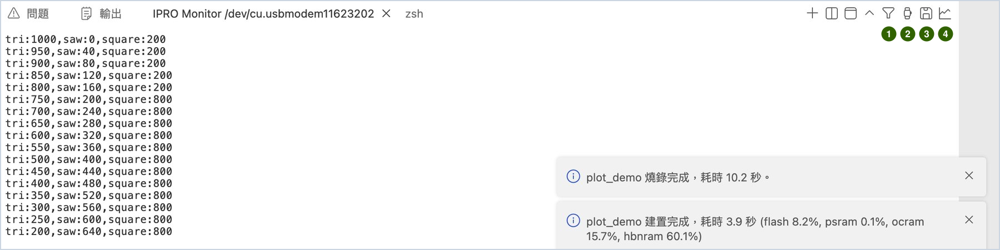
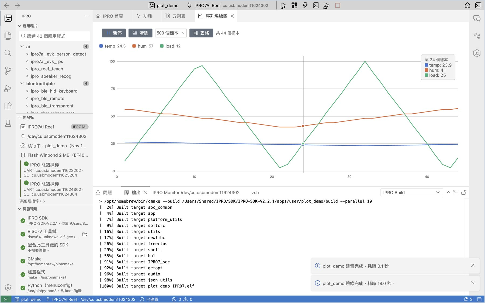

# 序列埠監看

**IPRO Monitor** 是下方面板「終端機」裡的序列埠監看，顯示板子從 UART 印出的內容，也可以直接打字送指令給板子。

## 開啟監看與輸入指令 { #open }

<div class="ipro-steps" markdown>

1. **開啟監看。** 按 **序列埠監看**（`Cmd+Alt+M`／`Ctrl+Alt+M`）。用 **建置、燒錄並監看** 時，燒錄完成後會自動開啟。

    **應該看到**：下方開出 **IPRO Monitor <連接埠>** 終端機，鮑率預設 115200。

2. **送指令。** 在監看裡打字，按 Enter 送出，例如輸入 `help`。

    **應該看到**：板子的 shell 回覆它支援的指令。

3. **重置開發板。** 要讓板子重新開機，按 **重置開發板**：IDE 透過探棒重置板子，監看保持開著，從開機的第一行開始顯示。

</div>

!!! note
    - 燒錄或重置前，IDE 會先關閉所有監看，完成後再重新開啟。
    - 鮑率在設定 `ipro.monitor.baudRate` 修改，修改後監看會自動重新開啟。
    - 監看會把板子印出的位址自動解碼成原始碼位置，見[除錯與分析](debug.md#crash-decode)。

## 監看頁籤上的工具 { #tools }

**IPRO Monitor** 頁籤所在的面板右上方有幾個按鈕；命令選擇區與 IPRO 選單也有同樣的命令。



| 編號 | 圖示 | 命令 | 用途 |
|---|---|---|---|
| 1 | 漏斗 | 篩選監看輸出… | 只顯示符合的行 |
| 2 | 碼錶 | 顯示監看時間戳記 | 每一行前面加上收到的時間 |
| 3 | 磁碟 | 儲存監看輸出… | 把目前的內容存成文字檔 |
| 4 | 曲線 | 序列埠繪圖 | 把板子印出的數字畫成曲線，見[序列埠繪圖](#plotter) |

### 篩選 { #filter }

<div class="ipro-steps" markdown>

1. **設定篩選。** 按漏斗圖示（**篩選監看輸出…**），輸入要留下的字，例如 `ERROR|WARN` 或 `PASS|FAIL`（正規表示式，不分大小寫），按 Enter。

    **應該看到**：監看重新開啟，頁籤標題後面多了 `/ERROR|WARN/`，只顯示符合的行。當機訊息（MEPC、ra、堆疊回溯）一律會顯示。

2. **取消篩選。** 再按漏斗圖示，清空輸入框後按 Enter。

</div>

篩選時一行要收完才判斷，所以 shell 提示字元要按 Enter 後才看得到。

篩選只影響畫面：[韌體核對](flash.md#board-flash)、[分割表比對](flash.md#partitions)與[板上測試](measure.md#board-tests)照樣讀得到板子印出的每一行，開著篩選也能使用。

### 時間戳記 { #timestamps }

按碼錶圖示（**顯示監看時間戳記**）。

**應該看到**：每一行前面多了收到的時間，例如 `[23:33:13.227]`（以這台電腦的時鐘為準）。再按一次關掉。

### 存檔與完整記錄 { #save-log }

<div class="ipro-steps" markdown>

1. **儲存目前的內容。** 按磁碟圖示（**儲存監看輸出…**），選位置後按 **儲存**。

    **應該看到**：通知「監看輸出已存到 monitor-….txt。」存下的是終端機目前保留的內容（預設最後 1000 行）。

2. **完整記錄每一次監看。** 開啟設定，搜尋 `ipro.monitor`，勾選 **Log To File**。

    **應該看到**：監看第一行寫著 `logging to …/build/logs/monitor-<日期>-<時間>.log`。檔案裡是板子印出的全部內容，不篩選、不含顏色。量功耗時，這份 log 可以和電流曲線對照（見[功耗](measure.md#power)）。

</div>

## 序列埠繪圖 { #plotter }

<div class="ipro-steps" markdown>

1. **讓韌體印出數字。** 讓韌體每行印出數字，例如 `temp:23.5,hum:40`（名稱:數值）或 `1.2 3.4`（以空白或逗號分隔）。同樣的 `名稱:數值` 也可以用[感測器儀表板](#dashboard)顯示。

2. **開啟序列埠繪圖。** 監看開著時，按監看頁籤上的曲線圖示（**序列埠繪圖**）。

    **應該看到**：編輯區開出「序列埠繪圖」，每個名稱一條線（最多 8 條），上方圖例顯示最新的數值。滑鼠移到圖上，會列出那個樣本的所有數值。

3. **操作畫面。** 按 **暫停**／**繼續** 凍結或恢復畫面，按 **清除** 重新開始；按圖例的名稱可以隱藏或顯示那條線；按 **表格** 改看數字。

</div>



## 同時監看另一個連接埠 { #second-port }

同時看兩塊板子，或探棒的 CCI 連接埠時：

<div class="ipro-steps" markdown>

1. **開第二個監看。** 選 IPRO 選單的 **在另一個連接埠開監看…**，選擇連接埠。

    **應該看到**：清單最上面是探棒的連接埠（UART、CCI），已經開著監看的連接埠不會列出。選了之後多一個 **IPRO Monitor** 頁籤。

2. **兩邊都能輸入。** 兩個監看都可以打字。燒錄或重置時，所有監看都會先關掉。

</div>

!!! note
    Windows 上一個 COM 埠同時只能給一個程式使用。要用其他序列埠工具時，請先關閉 IPRO Monitor。

## 感測器儀表板 { #dashboard }

「感測器儀表板」讀板子在序列埠印出的 `名稱:數值` 行（和[序列埠繪圖](#plotter)相同的格式），每個數值一張卡片，附單位；另有量表、指示燈、傾斜圖、每組一張曲線圖，以及在板子主控台上輸入指令的按鈕。版面寫在應用程式資料夾的 `dashboard.yaml`；沒有這個檔時，每個數值各有一張卡片與一張曲線圖。

下面以 IPRO SDK V2.3.0 的 [`ipro7ai_sensor_tag_demo`](https://github.com/INTELPRO-INC/IPRO-SDK/tree/IPRO-SDK-V2.3.0/apps/platform/ipro7ai_sensor_tag_demo) 在 IPRO7AI Sensor Tag 上示範，它的主控台在板子自己的 USB 埠上。

<div class="ipro-steps" markdown>

1. **燒錄並開監看。** 依[經開發板的 USB 燒錄](flash.md#usb-flash)把 `ipro7ai_sensor_tag_demo` 燒進 IPRO7AI Sensor Tag，連接埠選開發板的 USB 埠，按 **序列埠監看**。

    **應該看到**：IPRO Monitor 每秒出現 20 行，例如：

    ```text
    ax:0.012 ay:-0.004 az:1.003 gx:0.3 gy:-0.1 gz:0.0 temp:27.4 batt:87 vbat:4.012 btn:0
    ```

2. **開啟感測器儀表板。** 選 IPRO 選單的 **感測器儀表板**（或命令選擇區的 `IPRO: 感測器儀表板`）。監看還沒開時，IDE 會在目前的連接埠上開啟它。

    **應該看到**：編輯區開出「感測器儀表板」，標題是 `dashboard.yaml` 寫的 `IPRO7AI Sensor Tag`，下面一行是「每秒 … 行，來自 /dev/cu.usbmodemXXXX」與「依這個應用程式的 dashboard.yaml 排版」。接著是 Acceleration、Rotation 兩組（各三個數值、一張曲線圖；Acceleration 另有「傾斜」圖，寫著「俯仰 …° · 橫滾 …°」）與 Board 一組（Temperature、以量表顯示的 Battery、Battery voltage，以及指示燈 Button）。

3. **動一動板子。** 把板子傾斜，再按板上的按鍵。

    **應該看到**：傾斜圖跟著板子轉，加速度的曲線跟著變；按住按鍵時 Button 指示燈顯示「開」，放開時顯示「關」。滑鼠移到數值卡上，會顯示「<名稱>：自清除以來最低 …，最高 …」。

4. **按指令按鈕。** 按上方的 **Beep**。

    **應該看到**：板子的蜂鳴器響一聲。每個按鈕在主控台上輸入一行指令，**Beep** 輸入的是 `beep 200`；滑鼠移到按鈕上會顯示它的指令。

5. **暫停、清除與重新讀取。** 按 **暫停** 凍結畫面（按鈕變成 **繼續**），按 **清除** 重新開始統計。改了 `dashboard.yaml` 之後，按 **重新讀取 dashboard.yaml**。

</div>

`dashboard.yaml` 的寫法（節錄自 `ipro7ai_sensor_tag_demo`）：

```yaml title="dashboard.yaml"
title: IPRO7AI Sensor Tag
groups:
  - title: Acceleration
    unit: g
    range: [-2, 2]
    decimals: 3
    chart: true
    tilt: { x: ax, y: ay, z: az }
    values:
      - { name: ax, label: X }
      - { name: ay, label: Y }
      - { name: az, label: Z }
  - title: Board
    values:
      - { name: temp, label: Temperature, unit: "°C", decimals: 1 }
      - { name: batt, label: Battery, unit: "%", range: [0, 100], show: bar }
      - { name: btn, label: Button, show: lamp }
controls:
  - { label: Beep, send: beep 200 }
```

| 欄位 | 說明 |
|---|---|
| `title` | 儀表板的標題；沒寫時是「<應用程式> 的感測器」 |
| `groups` | 分組。每組有 `title`、`values`，可以給整組的 `unit`、`range`、`decimals` |
| `chart: true` | 這一組畫一張隨時間變化的曲線圖 |
| `tilt` | 用三軸加速度（`x`、`y`、`z` 寫數值名稱）畫俯仰與橫滾 |
| `values` | 每個數值：`name`（板子印出的名稱）、`label`、`unit`、`decimals`、`range`、`show` |
| `show` | `value`：只顯示數字（預設）；`bar`：數字加上在 `range` 中的位置；`lamp`：不為 0 時亮 |
| `controls` | 按鈕：`label` 是按鈕上的字，`send` 是要在主控台輸入的指令 |

!!! note
    - 應用程式沒有 `dashboard.yaml` 時，畫面寫「這個應用程式沒有 dashboard.yaml：板子印出的每個數值都會顯示。這個檔可以指定分組、單位、範圍與按鈕。」
    - `dashboard.yaml` 有錯時，錯誤以「dashboard.yaml 第 N 行：…」列出，寫錯的部分略過，其他照常顯示。
    - 監看沒開時，畫面寫「序列監看視窗沒有開啟」並附 **開啟監看** 按鈕；板子一段時間沒印數值時寫「… 已有一段時間沒有資料」。
